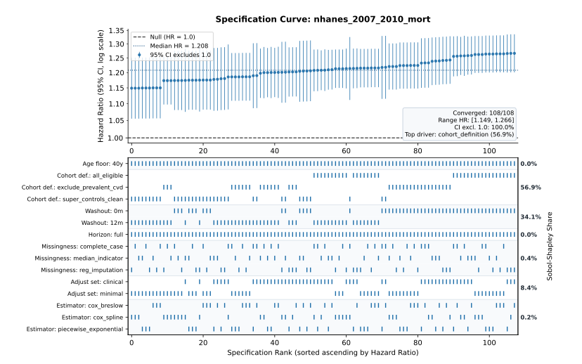

# multiverse-agent

**Outcome-blind epidemiological multiverse survival runner with exact Owen Sobol-Shapley variance attribution and a field-bound mechanical citation gate.**

`multiverse-agent` addresses two documented failure modes of single-pipeline observational survival studies and autonomous LLM analysts ([arXiv:2602.18710](https://arxiv.org/abs/2602.18710)):
1. **Analytical fragility & leakage:** Single-specification claims depend heavily on reverse-causation washout windows, control-group cleanliness (*SuperControls*), and missingness strategies—and naive LLM/pipeline automation steers estimates by 34–66 percentage points or leaks post-baseline mediators/colliders and survival times into imputation.
2. **Numeric hallucination & cherry-picking:** Narrative LLM summaries fabricate statistics, swap hazard ratios across runs, flip $p$-values across $\alpha = 0.05$, or omit unfavorable specifications.

---

## Real Empirical Finding: CDC NHANES 2007–2010 + 2019 Linked Mortality

We evaluate baseline serum C-reactive protein (`log_crp_z`, per 1-SD increment) and all-cause mortality across **11,055** US adults (**1,697** deaths over up to **159.0** follow-up months) across **108** conditional proportional-hazards specifications (`cox_breslow`, Royston-Parmar `cox_spline`, profiled Holford `piecewise_exponential`) in **< 9 seconds** on a developer CPU:



| Metric / Dimension | NHANES 2007–2010 (`11,055` adults, `1,697` deaths) | Tier 1 Reverse-Causation DGP (`n=4,000`, $\text{HR}_{\text{true}} = 1.20$) |
|---|---:|---:|
| Converged specifications | `108 / 108` | `108 / 108` |
| Median HR (range) | `1.208` (`[1.149, 1.266]`) | `1.320` (`[1.151, 1.617]`) |
| 95% CIs excluding `1.0` | `100.0%` | `100.0%` |
| #1 Sobol-Shapley driver | `cohort_definition` (`56.9%`) | `washout_months` (`78.0%`) |
| #2 Sobol-Shapley driver | `washout_months` (`34.1%`) | `cohort_definition` (`14.0%`) |
| #3 Sobol-Shapley driver | `adjustment_set` (`8.4%`) | `adjustment_set` (`7.9%`) |
| `missingness` + `estimator` | `0.4%` + `0.2%` | `0.2%` + `0.0%` |

### Methodological Note on Non-Collapsibility
All three estimators target the same **conditional hazard ratio** estimand per 1-SD in `log_crp_z`. Because Cox hazard ratios are mathematically non-collapsible across different covariate adjustment sets, the `8.4%` Sobol-Shapley share from `adjustment_set` (`minimal` vs. `clinical`) reflects both confounding control and conditional-scale non-collapsibility, whereas `estimator` agreement across Breslow, spline, and piecewise-exponential PH models accounts for only `0.2%` of total log-HR variance.

---

## 2-Minute Quickstart (100% Offline, `$0` API Cost)

```bash
# 1. Install dependencies (Python 3.12 + uv)
uv sync --all-extras

# 2. Run the full 108-branch NHANES multiverse, Sobol-Shapley curve, and citation audit
OMP_NUM_THREADS=1 OPENBLAS_NUM_THREADS=1 \
  uv run multiverse-agent run --cohort nhanes --backend replay --out artifacts/nhanes --png

# 3. Independently re-verify the generated report against sealed JSONL outputs
uv run multiverse-agent verify \
  --runs artifacts/nhanes/runs.jsonl \
  --summary artifacts/nhanes/curve_summary.json \
  --report artifacts/nhanes/report.md

# 4. Run full test suite + coverage + strict static gates
uv run pytest --cov=multiverse_agent --cov-fail-under=90
uv run ruff check src tests scripts && uv run mypy --strict src && uv run pip-audit
```

To run with a local or hosted LLM backend (`ollama`, `openai`, `anthropic`), pass `--backend ollama --model llama3.1:8b` or set `OPENAI_API_KEY` / `ANTHROPIC_API_KEY` with `--backend openai` / `--backend anthropic`.

---

## Architecture & Safety Firewalls

```text
CohortBundle ──▶ OutcomeBlindSchema (drops duration/event/UCOD_LEADING)
                        │
                        ▼
               OutcomeBlindArchitect (Stage 1: replay / ollama / openai / anthropic)
                        │   ├─ blocks POST_BASELINE_FOLLOWUP mediators (post_tx_statin)
                        │   └─ blocks HEALTHCARE_UTILIZATION_SELECTION colliders (hospitalized_past_year)
                        ▼
               SpecificationSpace (compiled Cartesian grid, canonical SHA-256 spec_id)
                        │
                        ▼
               MultiverseRunner (pre-washout cached imputation -> landmark T > W -> 3 PH fitters)
                        │
                        ├──▶ runs.jsonl (immutable SHA-256 RunRecords)
                        ├──▶ SpecCurveSummary + SVG/PNG (exact D=7 Owen 2014 Sobol-Shapley shares)
                        └──▶ GroundedSynthesizer (Stage 2) ──▶ eval_gate.verify_grounded_report()
```

### Architecture Decision Records
- [`docs/adr/0001-common-hazard-ratio-estimand.md`](docs/adr/0001-common-hazard-ratio-estimand.md) — Common PH estimand & pre-washout baseline caching
- [`docs/adr/0002-outcome-blind-agent-firewall.md`](docs/adr/0002-outcome-blind-agent-firewall.md) — Two-stage outcome-blind schema & `CollectionTiming` firewall
- [`docs/adr/0003-field-bound-citation-eval-gate.md`](docs/adr/0003-field-bound-citation-eval-gate.md) — Field-bound inline citations & metric-aware `eval_gate.py`
- [`data/DATASETS.md`](data/DATASETS.md) — CDC NHANES 2007–2010 + 2019 Linked Mortality provenance & SHA-256 manifest

---

## Containerized Reproduction

```bash
docker build -t multiverse-agent .
docker run --rm -v "$(pwd)/artifacts:/out" multiverse-agent \
  run --cohort nhanes --backend replay --out /out/nhanes
```
